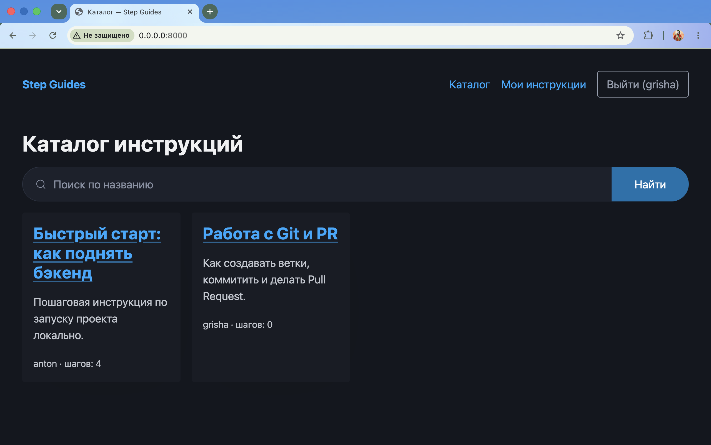
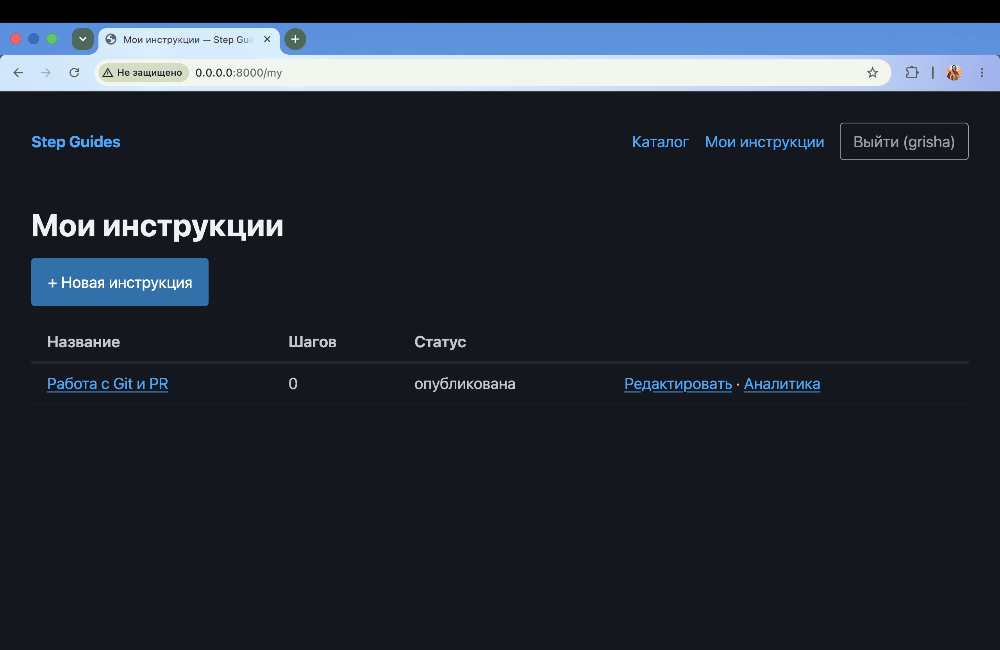
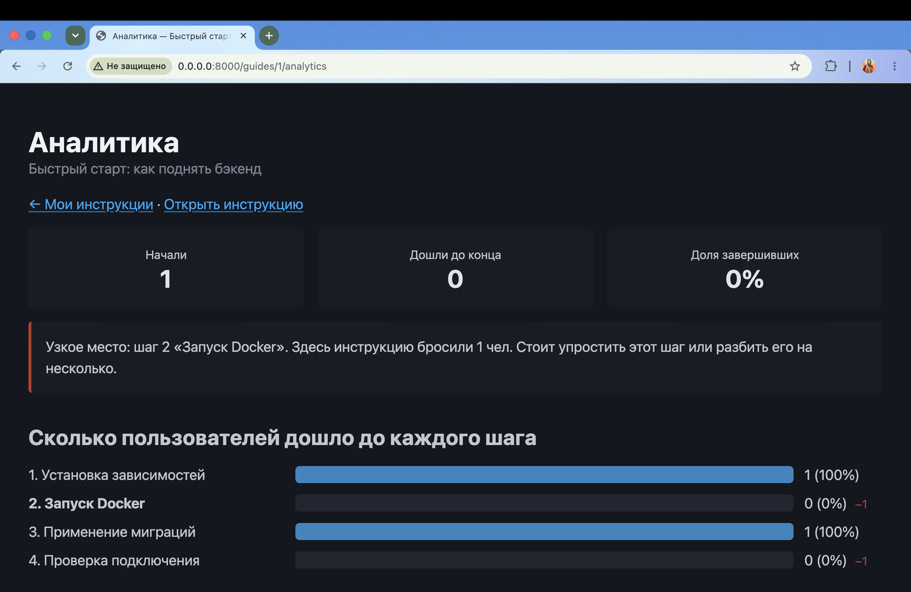

# Step Guides

Платформа интерактивных пошаговых инструкций с чек-листами (хакатон TASKILLS, трек «Веб-разработка»).

## Что умеет
- Каталог инструкций с поиском
- Прохождение инструкции: отметка шагов, прогресс-бар, прогресс сохраняется
- Личный кабинет автора: создание и редактирование инструкции с шагами
- Аналитика для автора: на каком шаге пользователи бросают инструкцию («узкие места»)

## Стек
FastAPI, SQLAlchemy 2.0, Alembic, SQLite / PostgreSQL, Jinja2 + HTMX, JWT в httpOnly-cookie, Docker.

## Запуск через Docker
    docker compose up --build
    docker compose exec web python scripts/seed.py   # тестовые данные (в другой вкладке)

Сайт: http://localhost:8000

## Запуск без Docker
    python3 -m venv .venv && source .venv/bin/activate
    pip install -r requirements.txt
    alembic upgrade head
    PYTHONPATH=. python scripts/seed.py
    uvicorn app.main:app --reload

## Тестовые пользователи
| Email | Пароль |
|---|---|
| grisha@taskills.com | secret123 |
| anton@taskills.com | secret123 |
| test@taskills.com | secret123 |

## Архитектура
- `app/models`: модели SQLAlchemy
- `app/services`: бизнес-логика (прогресс, аналитика, права автора)
- `app/routers`: HTTP-роуты и страницы
- `app/templates`: Jinja2 + HTMX
- `alembic`: миграции

## Скриншоты

## Команда
Frontend, Backend, База данных.
